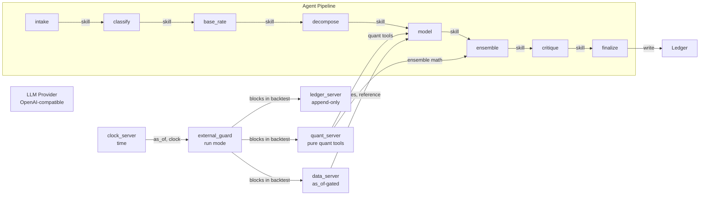

# forecast-agent

**A tool-using forecasting agent with deterministic actuarial and statistical tools, an append-only forecast ledger, and a scoring harness.**

[](https://github.com/chrisclayton94/forecast-agent)
[](https://beta.ruff.rs/)
[](https://www.python.org/downloads/)

---

## What it does

`forecast-agent` takes a vague forecasting question, turns it into a falsifiable prediction, computes a calibrated probability or quantile forecast using real quantitative tools, writes it immutably to an append-only ledger, and scores it later with actuarial-style accuracy measures.

The agent is **deterministic where it matters**: every number in a forecast comes from a tool call that actually executed code. If the input is unfalsifiable, the agent refuses instead of guessing.

---

## Key features

- **8-stage pipeline** — intake, classify, base rate, decompose, model, ensemble, critique, finalize
- **9 statistical tools** — ETS, ARIMA, walk-forward scoring, frequency-severity, Monte Carlo aggregation, Buhlmann credibility, chain-ladder, EVT, ensemble math
- **Append-only ledger** — `BEFORE UPDATE` / `BEFORE DELETE` database triggers guarantee immutability
- **Date-gated retrieval** — `data_server` refuses any request with `end > as_of`
- **8 skills** on demand — forecasting-and-measurement, fermi-estimation, critical thinking, pre-mortem, scenario planning, decision-making-under-uncertainty, sequential-thinking
- **MCP servers** — quant, data, ledger, clock, external guard
- **Run mode guard** — backtest vs live mode enforces zero external calls in backtest mode

---

## Quick start

```bash
# Create virtual environment and install
python -m venv .venv
uv sync

# Run the test suite (113 tests, ~14s)
uv run pytest -q

# Run the full evaluation harness
uv run src/forecast_agent/evals/run_all.py

# Run the CLI
uv run src/forecast_agent/cli.py
```

Requires Python 3.11+. Dependencies are via `uv` and `pyproject.toml`.

---

## Architecture



**Invariants:**

- **Append-only ledger** — `BEFORE UPDATE` / `BEFORE DELETE` triggers on `forecasts` raise `ABORT`.
- **Date-gated retrieval** — `data_server` refuses any request with `end > as_of`.
- **No LLM arithmetic** — every number in a forecast references a tool-call ID.

---

## Agent pipeline

| Stage | What it does | Skill used |
|-------|-------------|------------|
| **Intake** | Restate the question as falsifiable: variable, threshold, resolution source, resolution date. Refuses if impossible. | forecasting-and-measurement |
| **Classify** | Thin-tailed, fat-tailed, or mixed. Routes fat-tailed to Toolkit B (scenarios, EVT bounds). | decision-making-under-uncertainty |
| **Base rate** | Select reference class, call data server, record source or label `unverified_prior`. | forecasting-and-measurement |
| **Decompose** | Break into sub-questions mapping to quantitative tools. | forecasting-and-measurement |
| **Model** | Run baseline first, then a complex model only if it beats the baseline. | decision-making-under-uncertainty |
| **Ensemble** | N independent members (3–5), aggregated in code. If spread ratio exceeds threshold, switch to Toolkit B. | scenario-planning |
| **Critique** | Pre-mortem and disconfirming hypotheses. May widen intervals or lower confidence. | pre-mortem-and-red-teaming |
| **Finalize** | Bottom line first, then working. Validator rejects uncited numeric claims. Writes to ledger. | forecasting-and-measurement |

---

## Evaluation harness

One command regenerates all results:

```bash
uv run src/forecast_agent/evals/run_all.py
```

### Results (Phase 6)

| Eval | Result |
|------|--------|
| Walk-forward backtest | mae=0.458, rmse=0.621, beats baseline |
| Classifier eval | accuracy=1.0 on planted thin series |
| Credibility eval | blended_mean=3.057 > raw_mean=3.0, improved=true |
| Leakage eval | 100% blocked |
| Citation validator eval | 1 validated, 1 uncited caught |
| Calibration | mean_brier=0.20 |
| Regression tracker | 2/2 passed |

---

## Live ledger (Phase 7a)

The live ledger resolver runs on a configurable interval. When a question's resolution date passes, the resolver records the outcome and scores the forecast automatically.

**Run mode guard:** in backtest mode, every external call (clock, search, fetch, platform) raises `ExternalAccessBlocked` before any network activity. This is enforced in code, not by prompt. Test: `test_external_guard_blocks_all_calls_in_backtest`.

**Clock server:** injectable clock with `now()` (UTC, ISO 8601) and `days_until(date)`. Tests can freeze the clock, and the pipeline uses the clock in live mode.

### Current ledger state

| Metric | Value |
|--------|-------|
| Open questions | 0 |
| Resolutions recorded | 1 |
| Scores recorded | 1 |

---

## Techniques used

### Actuarial-style forecasting

The agent follows actuarial practice: bottom line first, working after. References include the Buhlmann credibility model for blending short-history groups, chain-ladder for claims development, and EVT (peaks-over-threshold) for fat-tailed series.

### Ensemble diversity

Ensemble members differ in model, prompt framing, and seed. The spread is reported explicitly, and a large spread triggers Toolkit B (scenarios, bounds) rather than a point prediction.

### Date-gated retrieval

All data tools take an `as_of` parameter. A request with `end > as_of` is refused at the data layer, preventing backtest leakage.

### Append-only ledger

The SQLite ledger uses `BEFORE UPDATE` and `BEFORE DELETE` triggers that raise `ABORT`. The only write path is `write_forecast` on the ledger server. No code path can modify past forecasts.

### Deterministic arithmetic

The LLM never produces numbers directly. The numeric-claim validator checks that every numeric claim in the final forecast references a tool-call ID from the same run.

---

## Development status

| Phase | Status |
|-------|--------|
| 0: Skeleton | ✅ Complete |
| 1: Quant library | ✅ Complete |
| 2: Synthetic data and gated store | ✅ Complete |
| 3: MCP servers | ✅ Complete |
| 4: Agent core | ✅ Complete |
| 5: Ensemble and spread rule | ✅ Complete |
| 6: Eval harness | ✅ Complete |
| 7a: Run mode guard and clock | ✅ Complete |
| 7b: Search, fetch, source registry | ⏳ Planned |
| 7c: Forecasting platform connector | ⏳ Planned |
| 7d: Observability and docs | ⏳ Planned |
| 8: Local model variant | ⏳ Planned |

---

## Package dependencies

```toml
[project]
dependencies = [
    "httpx>=0.27,<1.0",
    "mcp>=1.0,<2.0",
    "numpy>=1.26",
    "pandas>=2.1",
    "pydantic>=2.0",
    "scipy>=1.11",
    "statsmodels>=0.14",
    "typer>=0.12",
]

[project.optional-dependencies]
tracing = ["langfuse>=2.0"]

[dependency-groups]
dev = [
    "hypothesis>=6.0",
    "pytest>=8.0",
    "ruff>=0.4",
]
```

---

## License

MIT — see `LICENSE`.
