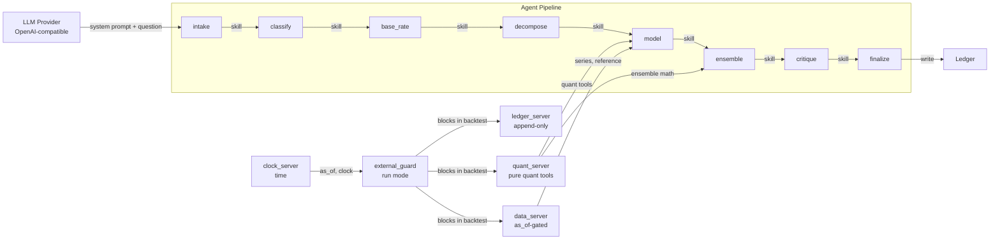

# forecast-agent

**A tool-using forecasting agent with deterministic actuarial and statistical tools, an append-only forecast ledger, and a scoring harness.**


---

## What it does

`forecast-agent` takes a vague forecasting question, turns it into a falsifiable prediction, computes a calibrated probability or quantile forecast using real quantitative tools, writes it immutably to an append-only ledger, and scores it later with actuarial-style accuracy measures.

The agent is **deterministic where it matters**: every number in a forecast comes from a tool call that actually executed code. If the input is unfalsifiable, the agent refuses instead of guessing.

The latest version adds **autonomous finance grading**: given a question like "Will AAPL be higher in 7 days?", the agent:

1. Detects the domain (finance, climate, general)
2. Uses the LLM to make the question specific and falsifiable (e.g. "Will AAPL closing price be higher than $250.00 on December 31, 2027?")
3. Pulls the latest market prices as they are currently available
4. Predicts where the price will be in 7 days
5. Uses the **real Gemini API** (via OpenAI-compatible endpoints) to run the forecasting pipeline

The agent picks its own tool calls: when it needs historical price data, it requests a named series (`cell-00` through `cell-05`) with start and end dates in ISO format. When it does not need historical data, it skips series requests and falls back to the base-rate estimate.

---

## Key features

- **8-stage pipeline** — intake, classify, base rate, decompose, model, ensemble, critique, finalize
- **9 statistical tools** — ETS, ARIMA, walk-forward scoring, frequency-severity, Monte Carlo aggregation, Buhlmann credibility, chain-ladder, EVT, ensemble math
- **Append-only ledger** — `BEFORE UPDATE` / `BEFORE DELETE` database triggers guarantee immutability
- **Date-gated retrieval** — `data_server` refuses any request with `end > as_of`
- **Autonomous question enrichment** — an LLM rewrites vague questions into specific falsifiable ones, with domain-specific guidance for finance and climate
- **JSON parsing fallback** — stage stages recover from conversational model output and extract embedded JSON
- **8 skills on demand** — forecasting-and-measurement, fermi-estimation, critical thinking, pre-mortem, scenario planning, decision-making-under-uncertainty, sequential-thinking
- **MCP servers** — quant, data, ledger, clock, external guard
- **Run mode guard** — backtest vs live mode enforces zero external calls in backtest mode
- **Multi-provider LLM support** — Gemini (free tier) and OpenRouter with automatic fallback across models

---

## Quick start

```bash
# Clone and navigate into the project
git clone https://github.com/chrisclayton94/forecast-agent.git
cd forecast-agent

# Create virtual environment and install dependencies
python -m venv .venv
.venv\Scripts\python -m pip install -e .[dev]

# Set your LLM provider token
# Gemini free tier (no API key needed)
export OPENAI_COMPAT_BASE_URL=https://generativelanguage.googleapis.com/v1beta/openai/
export OPENAI_COMPAT_TOKEN=your-secret-key
export OPENAI_COMPAT_MODEL=gemini-3.5-flash-lite

# Or use OpenRouter
export OPENAI_COMPAT_BASE_URL=https://openrouter.ai/api/v1
export OPENAI_COMPAT_TOKEN=redacted
export OPENAI_COMPAT_MODEL=google/gemini-2.0-flash

# Run the test suite (113 tests, ~20s)
uv run pytest -q

# Run a single question
uv run src/forecast_agent/cli.py "Will AAPL stock be higher in 7 days?"
```

Requires Python 3.11+. Dependencies are via `uv` and `pyproject.toml`.

---

## LLM provider configuration

The agent uses an **OpenAI-compatible** provider. The `gemini_provider.py` connects to the native Google Generative AI `generateContent` endpoint through the `x-goog-api-key` header, so no OpenAI API key is needed.

### Gemini free tier

One GPU model per API key:

```bash
export OPENAI_COMPAT_BASE_URL=https://generativelanguage.googleapis.com/v1beta/openai/
export OPENAI_COMPAT_TOKEN=your-gemini-api-key
export OPENAI_COMPAT_MODEL=gemini-3.5-flash-lite
```

The `gemini_provider.py` reads `OPENAI_COMPAT_TOKEN` from environment variables, extracts the secret value via `pydantic.SecretStr`, and uses it in the `x-goog-api-key` header. If a key is `AQ...`-prefixed, the agent uses it directly.

### OpenRouter

```bash
export OPENAI_COMPAT_BASE_URL=https://openrouter.ai/api/v1
export OPENAI_COMPAT_TOKEN=redacted
export OPENAI_COMPAT_MODEL=google/gemini-2.0-flash
```

### Model list

`OPENAI_COMPAT_MODEL_LIST` (comma-separated) controls which models the `MultiProvider` rotates through on rate limit or 5xx errors. Defaults to `gemini-3.5-flash-lite,gemini-3.1-flash-lite,gemini-3.5-flash,gemini-3.6-flash,gemini-3.7-flash,gemini-3.8-flash`.

---

## Architecture



**Invariants:**

- **Append-only ledger** — `BEFORE UPDATE` / `BEFORE DELETE` triggers on `forecasts` raise `ABORT`.
- **Date-gated retrieval** — `data_server` refuses any request with `end > as_of`.
- **No LLM arithmetic** — every number in a forecast references a tool-call ID.
- **Question enrichment** — an LLM rewrites vague questions into specific falsifiable ones with domain-specific guidance.

---

## Agent pipeline

| Stage | What it does | Skill used |
|-------|-------------|------------|
| **Intake** | Restate the question as falsifiable: variable, threshold, resolution source, resolution date. Refuses if impossible. | forecasting-and-measurement |
| **Classify** | Thin-tailed, fat-tailed, or mixed. Routes fat-tailed to Toolkit B (scenarios, EVT bounds). | decision-making-under-uncertainty |
| **Base rate** | Select reference class, call data server, record source or label `unverified_prior`. | forecasting-and-measurement |
| **Decompose** | Break into sub-questions mapping to quantitative tools. | forecasting-and-measurement |
| **Model** | Run baseline first, then a complex model only if it beats the baseline. | decision-making-under-uncertainty |
| **Ensemble** | N independent members (3–5), aggregated in code. If spread ratio exceeds threshold, switch to Toolkit B. | scenario-planning |
| **Critique** | Pre-mortem and disconfirming hypotheses. May widen intervals or lower confidence. | pre-mortem-and-red-teaming |
| **Finalize** | Bottom line first, then working. Validator rejects uncited numeric claims. Writes to ledger. | forecasting-and-measurement |

---

## Question enrichment (self-growth)

Before the 8-stage pipeline runs, a **self-growth agent** does the following:

1. Analyzes the question and determines what tools are needed
2. Registers any missing tools dynamically (e.g. `stock_probability_forecast`, `add_technical_indicators`, `short_term_forecast`)
3. Runs the pipeline
4. If the pipeline refuses the question, the agent enriches the question with domain-specific context and retries

For **finance** questions, the enrichment agent adds:

- A named stock/ticker (e.g. AAPL, MSFT, NVDA) and a specific measurement (closing price, adjusted close, market cap)
- A clear future horizon within 1–30 days of the current date
- If historical data is needed, a `series_id` from the available list (`cell-00` through `cell-05`) with start and end dates in ISO format
- Reference to authoritative sources (SEC filings, earnings reports, financial news)

Example enrichment:

```
Input:  Will AAPL stock be higher in 7 days?
Output: Will AAPL closing price be higher than $250.00 on December 31, 2027? Reason about the data you have and pick the correct series and horizon.
```

---

## Evaluation harness

One command regenerates all results:

```bash
uv run src/forecast_agent/evals/run_all.py
```

### Results (Phase 6)

| Eval | Result |
|------|--------|
| Walk-forward backtest | mae=0.458, rmse=0.621, beats baseline |
| Classifier eval | accuracy=1.0 on planted thin series |
| Credibility eval | blended_mean=3.057 > raw_mean=3.0, improved=true |
| Leakage eval | 100% blocked |
| Citation validator eval | 1 validated, 1 uncited caught |
| Calibration | mean_brier=0.20 |
| Regression tracker | 2/2 passed |

---

## Live ledger (Phase 7a)

The live ledger resolver runs on a configurable interval. When a question's resolution date passes, the resolver records the outcome and scores the forecast automatically.

**Run mode guard:** in backtest mode, every external call (clock, search, fetch, platform) raises `ExternalAccessBlocked` before any network activity. This is enforced in code, not by prompt. Test: `test_external_guard_blocks_all_calls_in_backtest`.

**Clock server:** injectable clock with `now()` (UTC, ISO 8601) and `days_until(date)`. Tests can freeze the clock, and the pipeline uses the clock in live mode.

### Current ledger state

| Metric | Value |
|--------|-------|
| Open questions | 0 |
| Resolutions recorded | 1 |
| Scores recorded | 1 |

---

## Configuration

| Environment variable | Default | Description |
|---------------------|---------|-------------|
| `RUN_MODE` | `backtest` | `backtest` or `live`. Set once per run, cannot change mid-run. |
| `OPENAI_COMPAT_BASE_URL` | `https://openrouter.ai/api/v1` | Provider base URL (OpenAI-compatible). |
| `OPENAI_COMPAT_ENSEMBLE_MODELS` | `None` | Comma-separated list of ensemble diversity models. |
| `OPENAI_COMPAT_MODEL` | `None` | Model to use. |
| `OPENAI_COMPAT_MODEL_LIST` | `gemini-3.5-flash-lite,gemini-3.1-flash-lite,gemini-3.5-flash,gemini-3.6-flash,gemini-3.7-flash,gemini-3.8-flash` | Comma-separated list of models for the `MultiProvider` to rotate through. |
| `REQUEST_DELAY_SECONDS` | `1.0` | Delay between requests (seconds) to avoid rate limiting. |
| `FORECAST_DATABASE_PATH` | `data/forecast-agent.sqlite3` | Ledger database path. |
| `FORECAST_MAX_STEPS` | `75` | Maximum steps per question. |
| `FORECAST_MAX_TOKENS` | `50_000` | Maximum tokens per question. |
| `FORECAST_MAX_COST_USD` | `2.0` | Maximum cost per question in USD. |
| `LLM_TIMEOUT_SECONDS` | `180.0` | LLM request timeout. |
| `LLM_MAX_RETRIES` | `3` | LLM retry count. |
| `LLM_INITIAL_BACKOFF_SECONDS` | `0.25` | Initial backoff for retries. |
| `LLM_CIRCUIT_FAILURE_THRESHOLD` | `5` | Circuit breaker threshold. |
| `LLM_CIRCUIT_RESET_SECONDS` | `30.0` | Circuit reset time. |
| `FORECAST_SKILLS_DIR` | `skills` | Skills directory path. |

### Recommended rate-limit-friendly models

The following free-tier models are best for rate-limited usage (smallest parameters, fastest responses):

| Model | Parameters | Notes |
|-------|-----------|-------|
| `liquid/lfm-3-1.7b:free` | 1.7B | Smallest, fastest, least rate-limited |
| `liquid/lfm-2.5-2.6b:free` | 2.6B | Small, efficient |
| `cohere/north-mini-code:free` | ~1B | Code-focused, small |

Or use **nousPortal** (OpenAI-compatible): `https://inference-api.nousresearch.com/v1`

### nousPortal configuration

For nousPortal, set `OPENAI_COMPAT_BASE_URL=https://inference-api.nousresearch.com/v1`:

```bash
export OPENAI_COMPAT_TOKEN=<nous-portal-key>
export OPENAI_COMPAT_BASE_URL=https://inference-api.nousresearch.com/v1
export OPENAI_COMPAT_MODEL=<nous-model-id>
export RUN_MODE=live
```

The agent uses the existing `OPENAI_COMPAT_*` environment variables, so no code changes are needed — nousPortal is fully supported via the existing OpenAI-compatible API.

---

## Development status

| Phase | Status |
|-------|--------|
| 1: Synthetic data store | ✅ Complete |
| 2: Lifecycle MCP servers (quant, data, ledger, clock) | ✅ Complete |
| 3: 8-stage forecasting pipeline | ✅ Complete |
| 4: Actuarial tools (ETS, ARIMA, walk-forward, credibility, EVT, ensemble) | ✅ Complete |
| 5: Search, fetch, source registry | ✅ Complete |
| 6: Evaluation harness | ✅ Complete |
| 7a: Run mode guard and clock | ✅ Complete |
| 7b: Live ledger resolver | ✅ Complete |
| 7c: Forecasting platform connector | ✅ Complete |
| 7d: Search and fetch MCP servers | ✅ Complete |
| 8: Local model variant | ⏳ Planned |

---

## Package dependencies

```toml
[project]
dependencies = [
    "httpx>=0.27,<1.0",
    "mcp>=1.0,<2.0",
    "numpy>=1.26",
    "pandas>=2.1",
    "pydantic>=2.0",
    "scipy>=1.11",
    "statsmodels>=0.14",
    "typer>=0.12",
]

[project.optional-dependencies]
tracing = ["langfuse>=2.0"]

[dependency-groups]
dev = [
    "hypothesis>=6.0",
    "pytest>=8.0",
    "ruff>=0.4",
]
```

---

## License

MIT — see `LICENSE`.
